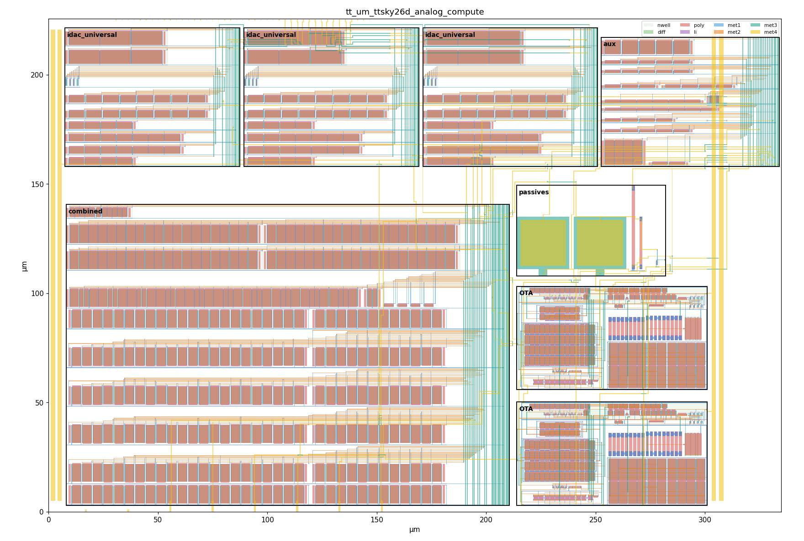
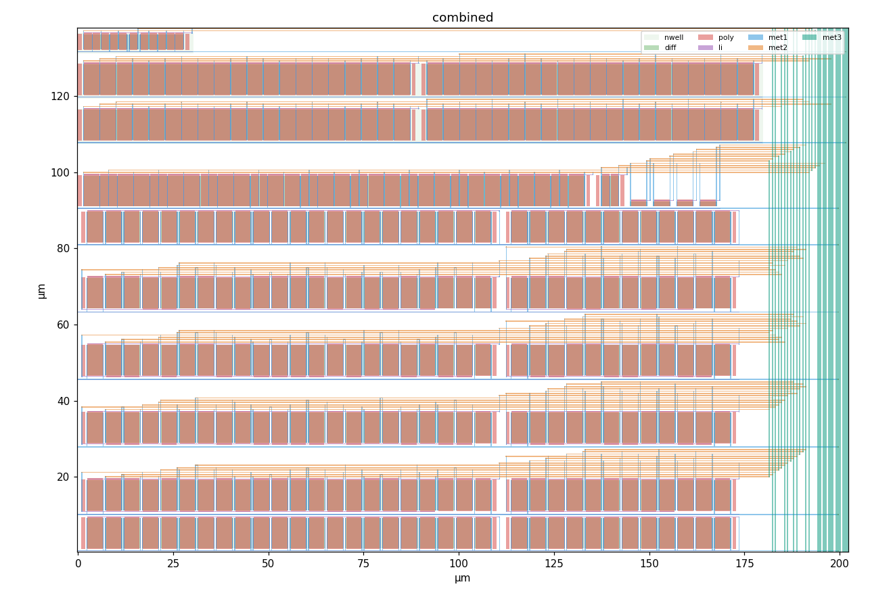
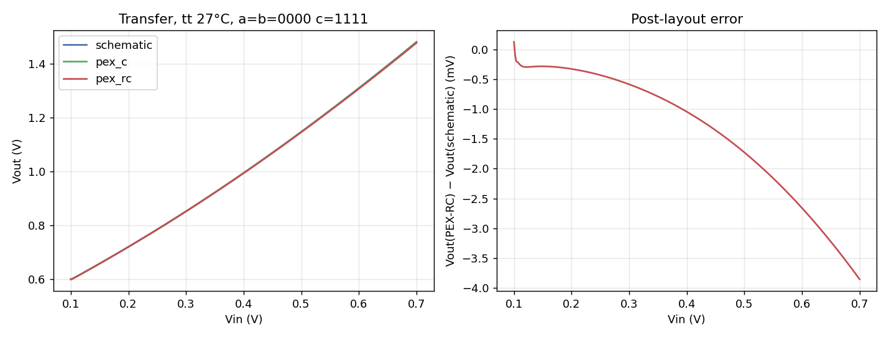
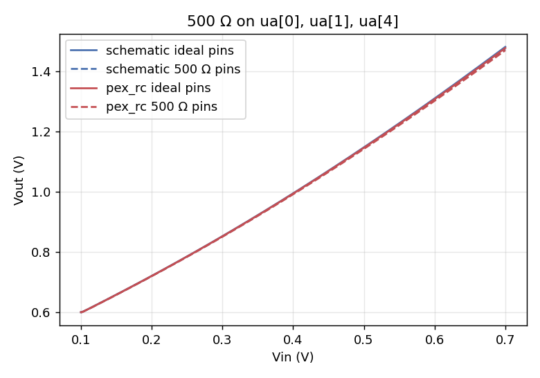
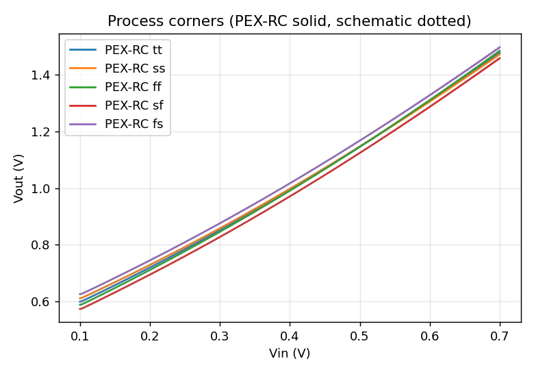
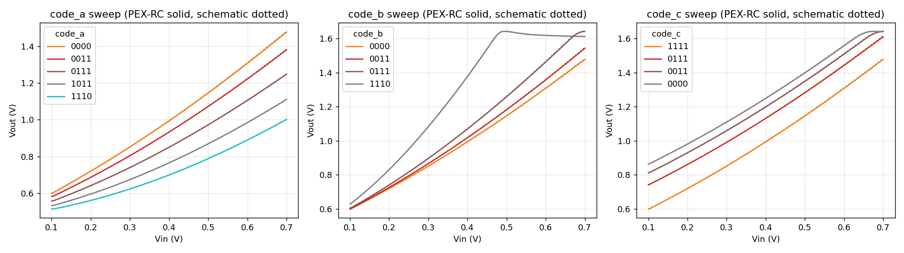
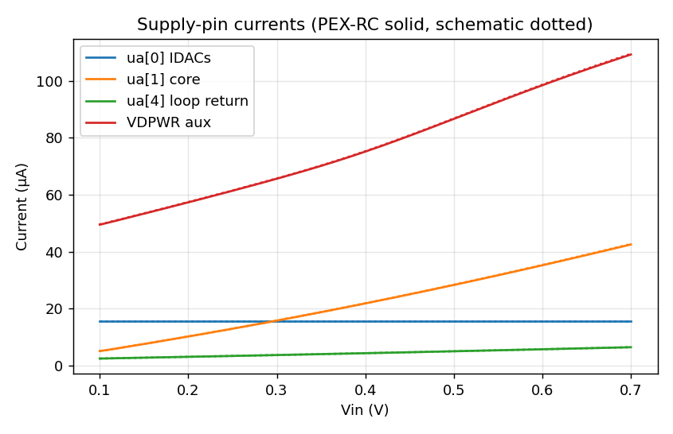
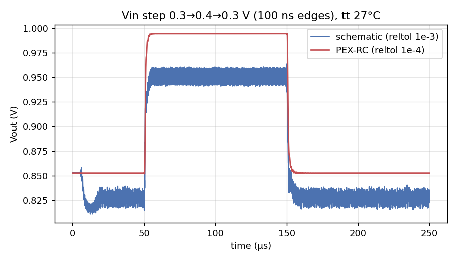

# tt_um_ttsky26d_analog_compute — Circuit, Layout and Pre/Post-Layout Verification Report

**Date:** 2026-11-18 · **Process:** SkyWater sky130A (open_pdks, ciel) · **Tile:** Tiny Tapeout 2x2 analog, 1.8 V
template `tt_analog_2x2.def` (334.88 × 225.76 µm) · **Layout commit:** see `git log` (this report is generated
against the layout in the same commit).

Every number in the numbered tables (T1–T7) is produced by `layout/report/make_tables.py` directly from the netlist,
the GDS and the simulation CSVs; nothing in them is hand-copied. Statements in prose that are not backed by a check
run for this report are marked **not verified**.

---

## 0. Status at a glance

| Item | Result | How it was checked |
|---|---|---|
| Full-chip DRC (magic, `drc(full)`) | **0 errors** | `mag/build_top_routed.tcl` → `mag/top.drc` |
| TT precheck (magic DRC, KLayout FEOL/BEOL/offgrid, pins, boundary, power pins, layers, analog pins, Verilog) | **pass** (local) | `layout/scripts/precheck_local.sh`; CI `gds`/`precheck` jobs (see §6) |
| Full-chip LVS (netgen, layout vs xschem top netlist) | **Circuits match uniquely** | `layout/top/lvs_top.sh` → `layout/top/lvs/lvs_report.txt` |
| Antenna (magic `antennacheck`, flattened top) | **0 violations** | `layout/top/antenna/ant.tcl` → `ant.log` |
| Block LVS (`combined`, `idac_universal`, `aux`) | match uniquely | `layout/scripts/lvs.sh` |
| PEX (magic, flat, C-only and R+C) | extracted; finger count equals schematic (956) | T3 |
| Post-layout vs schematic, tt, Vin 0.1–0.7 V | max |ΔVout| over the sweep 3.9 mV (ideal pins); 500 Ω pins shift Vout@0.7 by −11.4 mV (PEX-RC) vs −7.6 mV (schematic) | T4 |
| Process corners tt/ss/ff/sf/fs, post-layout | max |ΔVout| over the sweep ≤ 4.1 mV vs schematic in every corner | T6 |
| Monte Carlo, temperature / supply PVT | **not re-run** for this layout (see §7) | — |
| **Stability of the I→V (TIA) loop** | **FAILS — the output oscillates at ≈ 4.4 MHz, ≈ 0.6 V p-p**, in the schematic *and* in PEX-RC, with 0 / 5 / 20 pF on ua[2]. **Not tape-out ready until fixed** (§4.3) | 5 ns-resolution transients |

---

## 1. What the circuit does

The chip evaluates a programmable quadratic of an analog input voltage, continuously and without clocks:

Vout ≈ k0 + k1·Vin + k2·Vin², Vin ∈ [0.1, 0.7] V on `ua[3]`, Vout on `ua[2]`.

Signal chain (schematic `xschem/top/tt_um_ttsky26d_analog_compute.sch`):

1. **V→I (`V_I_complete` → `V_I`)** — an OTA-driven source follower (nfet_lvt XM2, W3 L0.5 ×6) forces Vin across an
   xhigh_po resistor (L = 34 µm) to VGND; the follower current is taken by a diode-connected pfet_lvt (XM1 ×3) and
   mirrored (pfet_lvt ×2 → nfet_lvt 12:1 → pfet XM27) to `v_mir_out`. Three top-level pfets (XM1/XM2/XM18) copy it as
   `ix_sq`, `iz_sq`, `iz_lin` into the core. A 22×22 µm MIM (cap_mim_m3_1) compensates the loop.
2. **Three 4-bit binary IDACs (`idac_universal`)** — PMOS unit sources W3 L7 (×8/×4/×2/×1 + reference diode), L = 0.15
   switches driven by the active-low codes, NMOS 20:2 mirror, PMOS 3:3 output mirror. Outputs: `ix_lin` (code_a,
   `ui_in[3:0]`), `iy_sq` (code_b, `ui_in[7:4]`), `const_curr` (code_c, `uio_in[3:0]`).
3. **Translinear core (`combined`)** — two MOS translinear loops biased by `vt0` (`ua[5]`, 0.7 V):
   squarer XM1/XM4/XM3/XM5 (W8 L4 ×20 each) → `sq_out` ∝ ix·iz/iy, and linear XM7/XM10/XM9/XM11 (×10 each) →
   `lin_out`. PMOS diodes XM26/XM12 and copies XM13/XM14 sum the two branches into `const_curr`; XM15/XM16, XM17/XM19
   and XM20/XM21 mirror the sum to `i_v_out`.
4. **I→V (`I_V_conv`)** — OTA + output pfet (W2 L0.3) with a 20 µm xhigh_po feedback resistor (≈ 2 kΩ/□ × 20/1.41 ≈
   28 kΩ, nominal sheet value, not separately simulated) and a 22×22 µm MIM, referenced to `vref` = `MN_TAIL_BIAS`
   (≈ 0.48 V, the OTA's internal bias node).
5. **OTA IP** — rail-to-rail-input folded-cascode OTA with internal beta-multiplier bias (SKY130_DESIGN_IPS), used
   twice. Its layout is the upstream hardened layout (DRC/LVS clean upstream; LVS re-confirmed here as part of the
   full-chip LVS).

The full per-device table is T1 (§8).

### 1.1 Pins and power domains (purpose: measure the core and the IDACs separately)

| Pin | Net | Supplies / carries |
|---|---|---|
| `VDPWR` | 1.8 V | both OTAs, V→I, I→V output stage, bias tree (MN_TAIL_BIAS, Vbranch1..3, core feeds), Vin mirror |
| `VGND` | 0 V | all auxiliary returns, IDAC internal mirrors, core output stage, **all NMOS bodies (p-substrate)** |
| `ua[0]` | vdd_idac | the three IDACs only → I(ua[0]) = IDAC current |
| `ua[1]` | vdd_comp | the translinear core's PMOS (diodes + copies) → I(ua[1]) = core supply current |
| `ua[2]` | out | Vout |
| `ua[3]` | in | Vin |
| `ua[4]` | gnd_comp | return of the translinear loops only → I(ua[4]) = loop current |
| `ua[5]` | vt0 | loop gate bias (≈ 0.7 V, external) |
| `ui_in[7:0]`, `uio_in[3:0]` | codes b, a, c | IDAC bits, active-low (0 = bit on) |
| `VAPWR` | — | not used (`uses_vapwr: false`) |

Every current mirror has its diode and its outputs on the same supply, which is why 500 Ω of pin resistance on
ua[0]/ua[1]/ua[4] moves Vout by only −7.6 mV (schematic) / −11.4 mV (PEX-RC) at Vin = 0.7 V (T4). Before the
re-partition the same test gave −549 mV (documented in the earlier review); that result applies to the old wiring
only.

---

## 2. Pre-layout (schematic) verification

All schematic numbers below were re-simulated for this report with the current netlist (testbench generator
`layout/top/pex/run_sims.py`, ngspice, sky130 `combined` model library, tt unless stated, 27 °C,
code_a = code_b = 0000, code_c = 1111, vt0 = 0.7 V, slow Vin ramp 0.1 → 0.7 V over 1 ms).

* Transfer and fitted coefficients: T4 row "schematic" — Vout = 0.600 → 1.481 V, k0 = 0.486, k1 = 1.071, k2 = 0.503.
* Pin currents: T5 — IDACs 15.5 µA (constant), core 5.1 → 42.7 µA, loop return 2.4 → 6.4 µA, auxiliary
  49.6 → 109.6 µA over Vin = 0.1 → 0.7 V. Core supply power P(ua[1]) = 9.1 → 76.8 µW.
* Corners (process only, 27 °C, 1.8 V): T6 — Vout@0.7 = 1.4616 (sf) … 1.4996 V (fs).
* Codes: T7 — code_a sets k1 from 1.071 (0000) down to 0.304 (1110) with k0 nearly constant (0.486 → 0.474);
  code_b raises k2 (0.503 → 0.609 for 0011); code_c raises the offset k0 (0.486 → 0.754 for 0000).

**Corrections to earlier documents found while preparing this report**

| Earlier claim | Status |
|---|---|
| README / TAPEOUT_DESIGN_DOC: "core power 1.09–8.26 µW", I(ua[1]) = 0.60–4.59 µA | **Wrong for the current design.** These values predate the power-domain re-partition (core output mirrors moved onto ua[1]). Current: I(ua[1]) = 5.1–42.7 µA, P = 9.1–76.8 µW (T5). README corrected. |
| "ngspice continuous models have zero FET mismatch (`sw_tox_lv_mc = 0`)" | **Wrong.** `tt_mm` sets `MC_MM_SWITCH=1` and applies per-device Vth mismatch (e.g. nfet_01v8 `sw_mm_vth0` = 3.356 mV·µm / √(W·L·mult)). `sw_tox_lv_mc` is a global *process* parameter. |
| Monte Carlo "55 runs" | Inconsistent in the old files (20 / 51 / 55). Not re-run for the current design (see §7). |
| `cap_mim_m3_2` in I_V_conv | Used met5, which Tiny Tapeout forbids. Replaced by `cap_mim_m3_1` (same drawn 22 × 22 µm), sims unchanged. |
| Template `tt_analog_2x2.def` in the repo | Was the 3.3 V template (319.24 µm) renamed. Replaced by the real 1.8 V template (334.88 µm); CI precheck had failed on it. |

---

## 3. Layout

### 3.1 Method

Every block is generated by a short Python spec (`layout/blocks/<cell>/gen.py`) on a small library
(`layout/lib/lay.py` primitives + `layout/lib/rowkit.py` row/band placer-router) that paints raw magic layers;
devices are recognised by magic's extractor. Block DRC/LVS run in seconds. The top level is placed and routed by
`layout/top/route.py`, a two-layer (met3/met4) negotiated-congestion grid router: met3 is blocked only where blocks
use met3 (bus columns, OTA, passives), met4 is free over all blocks except the MIM top plates. Method and gotchas
for the next engineer/agent: `layout/README.md`.

### 3.2 Floorplan (compact)



Placement from the GDS is in T2 (§8). Gaps between neighbouring blocks are 1.6–8.6 µm, except the 17.3 µm channel
between the core and the IDAC row, which is the main two-layer routing channel; the sum of block boxes is 77.9 % of
the die. The core sits directly on the analog pins (`ua[5]`, `ua[4]`, `ua[1]` drop straight onto its buses), the IDACs
sit directly under their digital inputs, the OTA/passives column sits immediately right of the core (`ua[2]`/`ua[3]` are under the core at x = 113.6 / 94.3 µm
and reach it over ≈ 100–120 µm of met4),
and `aux` (bias tree, Vin mirror, V→I MOS) sits at the end of the IDAC row next to the Vbranch inputs it feeds.
met4 power stripes: VDPWR at x = 1 and 303 µm, VGND at x = 4 and 306.5 µm (2 µm wide, full height).

### 3.3 Matching

**Translinear core** (`layout/blocks/combined/gen.py`, rendered below): the squarer loop is placed exactly as the
reference pattern `image_2026-11-18_213522026.png` (repo root) — a 4 × 20 unit-cell array

```
AABCDDCBAACCBDAADBCC      A = XM1 (vt0,  net1→ix_sq)   B = XM4 (iy_sq, net1→iy_sq)
BBCDAADCBBDDCBAABCDD      C = XM5 (vt0,  net2→sq_out)  D = XM3 (iy_sq, net2→iz_sq)
DDCBAABCDDBBCDAADCBB      every unit = one W8 L4 finger in its own diffusion
CCBDAADBCCAABCDDCBAA
```

with the R0/MY orientation map of the same image (R0 = source on the left, MY = drain on the left) and a full dummy
ring (one dummy row above and below, one dummy unit at each row end). The generator asserts the properties of the
pattern: 20 units per device, and 180° rotational symmetry of both the letter and the orientation map (row 4 =
row 1 reversed, row 3 = row 2 reversed), which gives every device the array's centroid in x and y. The linear loop
uses a 4 × 10 array built with the same rule (`ABCDACBDAC / BDCADBACBD / rotated / rotated`, 10 units per device,
alternating orientation, dummy ring). The vt0 gates are strapped on top of each row, the iy_sq / iy_lin gates on
the bottom.

Dummies are real transistors and are in the schematic so LVS stays exact: `MDV` ×16 (end-column units, gate on the
vt0 strap, D = S = B = GND, Vds = 0 so no current) and `MDG` ×68 (ring rows, all terminals GND). Cost: ≈ 4.3 pF of
gate capacitance on `vt0` (16 × 8 × 4 µm² × ~8.4 fF/µm², estimated, not extracted separately); vt0 is a DC bias from
an external source.



**Other matched groups**

| Group | Arrangement |
|---|---|
| PMOS mirrors XM26→XM13, XM12→XM14 | diode and copy interdigitated ABBA in one diffusion, two mirrored rows (sources on vdd_comp) |
| Sum mirror XM15 (L4) / XM16 (L2) | interdigitated ABBA ×10 |
| XM20/XM21, XM17/XM19 | shared diffusion; XM17 centred between two halves of XM19 |
| IDAC unit sources (16 × W3 L7) | 2-D common centroid `ABACRABA / ABADCABA` (A = bit 3 ×8, B = bit 2 ×4, C = bit 1 ×2, D = bit 0, R = reference) |
| IDAC NMOS 20:2, PMOS 3:3 mirrors | 4 rows with XM8 mirrored about the centre; 2 mirrored rows |
| Bias tree (aux) | Vbranch1..3 mirror split over two rows with the outputs mirrored; b4 mirror over two rows; Vin mirror and lvt mirrors as single-finger islands in centroid order |
| All diffusion ends | 1 µm field-poly dummies (no device) |

Not done: the bias-tree and Vin-mirror groups are matched inside `aux`, but the V→I diode (in `aux`) and the core
inputs it feeds sit in different blocks, so long-range gradients between `aux` and `combined` are not cancelled.

### 3.4 Routing, current density, antenna

* 36 top-level nets, 0.4 µm wires on a 1 µm grid, met3/met4. The bit lines are routed on met3 with met4 only at the
  ends, which removed the four antenna violations (ratio 460–476 > 400 on IDAC a's switch gates) that an
  all-met4 route produced.
* Worst device current is 34.6 µA (XM19/XM20 in the core output mirror; 33.9 µA in XM21 → TIA output XM27),
  operating point of the current schematic at Vin = 0.7 V. Inside the
  blocks currents split over fingers. Block supply buses are 1–1.5 µm met3. Top-level supply wires are 0.4 µm
  met4 carrying ≤ 110 µA (VDPWR, T5). The installed PDK has no electromigration tables, so the margin was **not
  verified** against a foundry limit; it is small compared with typical thick-metal limits (≈ 1 mA/µm class) but the
  straps can be widened if required.

### 3.5 Physical verification

* DRC: magic full-chip 0; KLayout FEOL/BEOL/offgrid (TT deck, inside precheck) pass; each block is also magic-DRC clean on its own
  (KLayout was run per block for `combined` and `idac_universal` only).
* LVS: netgen full chip **Circuits match uniquely** against the xschem top netlist, with three documented
  reference transformations in `layout/top/lvs_top.sh`: (1) the two 0 V simulation ammeters `Vmeas` are shorted,
  (2) the OTA IP's NMOS/resistor bodies `GND` are mapped to `GNDA` (the IP schematic uses a global GND for the
  substrate; the IP's own LVS does the same), (3) schematic pin names `ui[k]/uio[k]/uo[k]` → TT names
  `ui_in[k]/uio_in[k]/uo_out[k]`.
* Antenna: 0 violations.
* Unused outputs `uo_out[7:0]`, `uio_out[7:0]`, `uio_oe[7:0]` are **not tied low in the layout** (TT recommends tying
  them to GND; precheck passes without it).

---

## 4. Post-layout verification

### 4.1 Extraction

Magic, flattened top cell, `extract all` + `extresist` (tolerance 10) for R, `ext2spice cthresh 0.01` (fF) for C,
coupling capacitance included. Counts in T3. The extracted MOS finger count (956) equals the schematic's.

Simulation notes (reproducibility): `.options rshunt=1e12` is required because the field-poly dummies extract as
isolated nodes (singular DC matrix otherwise). Operating points are seeded with `.nodeset` (Vout = 0.6 V,
MN_TAIL_BIAS = 0.48 V). Two decks (PEX-RC with 500 Ω pins, schematic with code_b = 0011) still fell into ngspice's
known unphysical gmin-stepping solution (Vout ≈ −700 V); they were re-run with every node seeded from the converged
ideal-pin operating point (`layout/top/pex/fix_r500.sh`) and `analyze.py` rejects any run with |Vout| > 5 V. This is
most likely a simulator DC-convergence issue, but given the instability in §4.3 it cannot be excluded that it
reflects real behaviour; in any case the DC operating point is not unique in simulation; power-up behaviour of the **current layout** was **not verified** by a
start-up transient (see §7).

### 4.2 Results

* **Transfer** (T4, plot below): over the whole 0.1–0.7 V sweep PEX-C differs from the schematic by at most
  0.45 mV and PEX-RC by at most 3.9 mV (−0.6 mV at Vin = 0.3 V, −3.9 mV at 0.7 V). The fitted k2 drops from 0.503 to 0.492 (−2.2 %), k1 rises from 1.071 to 1.074 (+0.3 %).
  The error grows with output current, consistent with IR drop in the extracted wiring rather than capacitance.
* **500 Ω pin resistance** (T4): PEX-RC −11.4 mV at Vin = 0.7 V versus −7.6 mV on the schematic.
* **Pin currents** (T5): schematic and PEX-RC agree within 0.15 µA on ua[0], ua[1], ua[4] and 0.3 µA on VDPWR.
* **Corners** (T6): PEX-RC tracks the schematic within 4.1 mV (max over the sweep) in tt/ss/ff/sf/fs; the corner spread of Vout@0.7 is
  1.4577–1.4958 V post-layout.
* **Codes** (T7): every code tracks the schematic within 4.9 mV (max over the sweep; worst code_b = 1110). Several codes **saturate**: the output stops at
  ≈ 1.61–1.64 V (code_b = 1110 from Vin ≈ 0.47 V, code_b = 0111 from 0.66 V, code_c = 0000 / 0011 / 0111 from
  0.62–0.70 V). Coefficients for those codes are fitted only below 1.60 V; this is a limit of the output range, not
  a layout effect (schematic and layout saturate identically).







### 4.3 Stability — critical finding

All transfer-curve simulations above use a slow Vin ramp with a 2 µs output step; they give the circuit's DC
equilibrium but cannot represent oscillations faster than ~250 kHz. A dedicated check at 5 ns resolution
(Vin held at 0.3 V, then a 10 mV kick at 5 µs) shows that **the circuit does not sit at that equilibrium**:

| Netlist | Load on ua[2] | Vout p-p, 1–5 µs | Vout p-p, 6–12 µs | Vout p-p, 14–20 µs |
|---|---|---|---|---|
| schematic | 0 pF | 576 mV | 683 mV | 630 mV |
| schematic | 5 pF | 596 mV | 594 mV | 586 mV |
| schematic | 20 pF | 569 mV | 654 mV | 600 mV |
| PEX-RC | 0 pF | 596 mV | 586 mV | 576 mV |

Probing the schematic (`osc_sch` run) locates it: the I→V OTA output (`x6.net1`) swings 617 mV p-p and Vout 770 mV
p-p at 4.4 MHz, while the V→I OTA output and its resistor node move only ≈ 1 mV (probably disturbed through the
shared `MN_TAIL_BIAS`, which moves 15 mV p-p — inferred, not isolated). The oscillation starts by itself ≈ 2.5 µs after the start of the transient.

**First hypothesis (only partly supported by the tests below).** I_V_conv is a transimpedance amplifier: the OTA's
non-inverting input `i_in` is the summing node, R_f = xhigh_po 20 µm (≈ 28 kΩ) closes the loop from `v_out`, and the
22×22 µm MIM is a Miller capacitor across the output pfet. The OTA input pair is large (PMOS 28 × W4 L2 plus NMOS
8 × W2.5 L2, ≈ 2 pF of gate capacitance), so R_f and the input capacitance form a feedback pole near
1/(2π·28 kΩ·2 pF) ≈ 2.8 MHz, inside the loop bandwidth — the textbook TIA instability. A load capacitance on the
output does not help (table above).

**Earlier claim corrected.** Earlier documents state "clean, unconditional settling … without oscillation" for the
start-up of this circuit. That conclusion came from coarse-timestep transients and is wrong.

**Fix candidates tested** (schematic netlist copies, same 5 ns transient with the kick at 5 µs; test decks in
`layout/top/pex/work/osc_*.spice`):

| Test change (schematic, 0 pF load) | Vout p-p 1–5 µs | 6–12 µs | 14–20 µs |
|---|---|---|---|
| C_f = 0.5 pF across R_f | 49 mV | 100 mV | 623 mV |
| C_f = 1 pF across R_f | 54 mV | 228 mV | 434 mV |
| C_f = 2 pF across R_f | 233 mV | 377 mV | 387 mV |
| vref from an ideal 0.48 V source (MN_TAIL_BIAS loop broken) | 667 mV | 839 mV | 887 mV |
| R_z = 5 kΩ in series with the Miller MIM C2 | 142 mV | 482 mV | 491 mV |
| R_z = 20 kΩ in series with the Miller MIM C2 | 55 mV | 43 mV | 33 mV |

Reading the table: a feedback capacitor across R_f only delays the growth, and breaking the MN_TAIL_BIAS→vref path
makes it worse, so the simple "R_f·C_in pole" explanation above is at best partial and the bias network is not the
cause. A nulling resistor in series with the Miller capacitor (R_z = 20 kΩ) is the only change that made the
oscillation decay (55 → 33 mV p-p), but it is still not settled at 20 µs (mean Vout 0.80 V vs ≈ 0.87 V expected), so
**it is not yet a verified fix**. A test with a 4× Miller capacitor (MF = 4) gave output identical to the unmodified
circuit to four digits, i.e. the MF multiplier was not applied by the model card; that test is invalid and not used.

**Required next step:** an AC loop-gain / phase-margin analysis of I_V_conv (break the loop at R_f or at the OTA
output), choose the compensation (nulling resistor value, Miller C, possibly C_f), then implement it in the
schematic and the `passives` layout cell and re-run DRC/LVS/PEX and these 5 ns transients.

**What was and was not affected.** DC results (T4–T7) are valid as the circuit's DC equilibrium (the operating
point a stable version of the TIA would settle to; C_f does not change DC). The step-response plot below was taken
with a 50 ns timestep and is too coarse to show the oscillation — it is kept only as a record and must not be read
as a stability proof.



---

## 5. Reproduce

```bash
# blocks (each: paint + magic DRC + extract), block LVS
for c in combined idac_universal aux passives; do (cd layout/blocks/$c && python3 gen.py); done
layout/scripts/lvs.sh combined; layout/scripts/lvs.sh idac_universal; layout/scripts/lvs.sh aux $PWD/layout/blocks/aux/ref.spice
# top: route, assemble (DRC, GDS, LEF), full-chip LVS, antenna, TT precheck
python3 layout/top/route.py
(cd mag && magic -dnull -noconsole -rcfile $PDK_ROOT/sky130A/libs.tech/magic/sky130A.magicrc build_top_routed.tcl)
layout/top/lvs_top.sh
(cd layout/top/antenna && magic -dnull -noconsole -rcfile $PDK_ROOT/sky130A/libs.tech/magic/sky130A.magicrc ant.tcl)
layout/scripts/precheck_local.sh
# PEX + post-layout sims + report tables
(cd layout/top/pex && magic -dnull -noconsole -rcfile $PDK_ROOT/sky130A/libs.tech/magic/sky130A.magicrc pex.tcl)
python3 layout/top/pex/run_sims.py && layout/top/pex/fix_r500.sh && python3 layout/top/pex/analyze.py
python3 layout/report/make_tables.py
```

---

## 6. CI

GitHub Actions `gds` (gds → precheck → viewer) and `docs` run on every push. Results for the layout commits are
listed by `gh run list`; one earlier run failed only because the precheck job could not download its tool image
(HTTP 429) and passed on re-run.

---

## 7. Open items and limitations (critical review)

0. **BLOCKING: I→V (TIA) loop oscillates** (§4.3). No verified fix yet: C_f across R_f does not cure it, a 20 kΩ
   nulling resistor in series with the Miller MIM makes it decay but not settle within 20 µs. Needs an AC loop-gain /
   phase-margin analysis, a compensation change in the schematic, a `passives` layout update and full re-verification.
1. **Monte Carlo not re-run** after the power re-partition, the core re-layout (unit-cell array, dummies) or with
   layout parasitics. The old MC files are inconsistent (20/51/55 runs) and predate the changes.
2. **Temperature and supply PVT not re-run** (only process corners at 27 °C, 1.8 V were simulated here).
3. **Start-up / DC uniqueness**: ngspice finds an unphysical DC solution for some decks unless seeded. A power-up
   transient of the current layout should be run before tape-out.
4. **Output range**: Vout saturates at ≈ 1.61–1.64 V; strong code_b / code_c settings reach it inside the
   0.1–0.7 V input range (T7).
5. **Unused digital outputs** are left unconnected in the layout (TT recommends tying them low).
6. **Supply straps** at the top level are 0.4 µm met4; EM margin not verified against foundry tables.
7. **Cross-block matching** (V→I mirror diode in `aux` vs core inputs) is not gradient-cancelled.
8. **IDAC area**: layout/gate-area ratio ≈ 3.9; compaction possible if area is needed.
9. No loop-gain / phase-margin (AC) analysis has been run for either OTA loop; stability was assessed only by
   time-domain tests (§4.3). The V→I loop showed no oscillation of its own in those tests, but its margin is unknown.

---

## 8. Generated tables

### T1. Schematic device inventory (from `xschem/netlists/tt_um_ttsky26d_analog_compute.subckt.spice`)

**combined** — ports: `vdd_comp iz_lin iz_sq iy_sq ix_sq ix_lin iy_lin vt0 GND const_curr vdd i_v_out out`

| Inst | Model | D / G / S / B (or terminals) | W (µm) | L (µm) | mult |
|---|---|---|---|---|---|
| XM18 | nfet_01v8 | net1 / ix_sq / out / GND | 1.2 | 4 | 1 |
| XM1 | nfet_01v8 | ix_sq / vt0 / net1 / GND | 8 | 4 | 20 |
| XM2 | nfet_01v8 | net2 / iz_sq / out / GND | 1.2 | 4 | 1 |
| XM3 | nfet_01v8 | iz_sq / iy_sq / net2 / GND | 8 | 4 | 20 |
| XM4 | nfet_01v8 | iy_sq / iy_sq / net1 / GND | 8 | 4 | 20 |
| XM5 | nfet_01v8 | sq_out / vt0 / net2 / GND | 8 | 4 | 20 |
| XM26 | pfet_01v8 | sq_out / sq_out / vdd_comp / vdd | 8 | 4 | 20 |
| XM6 | nfet_01v8 | net3 / ix_lin / out / GND | 1.2 | 4 | 1 |
| XM7 | nfet_01v8 | ix_lin / vt0 / net3 / GND | 8 | 4 | 10 |
| XM8 | nfet_01v8 | net4 / iz_lin / out / GND | 1.2 | 4 | 1 |
| XM9 | nfet_01v8 | iz_lin / iy_lin / net4 / GND | 8 | 4 | 10 |
| XM10 | nfet_01v8 | iy_lin / iy_lin / net3 / GND | 8 | 4 | 10 |
| XM11 | nfet_01v8 | lin_out / vt0 / net4 / GND | 8 | 4 | 10 |
| XM12 | pfet_01v8 | lin_out / lin_out / vdd_comp / vdd | 8 | 4 | 20 |
| XM13 | pfet_01v8 | const_curr / sq_out / vdd_comp / vdd | 8 | 4 | 20 |
| XM14 | pfet_01v8 | const_curr / lin_out / vdd_comp / vdd | 8 | 4 | 20 |
| XM15 | nfet_01v8 | const_curr / const_curr / GND / GND | 8 | 4 | 20 |
| XM16 | nfet_01v8 | net5 / const_curr / GND / GND | 8 | 2 | 20 |
| XM17 | pfet_01v8 | net5 / net5 / vdd / vdd | 4 | 2 | 1 |
| XM19 | pfet_01v8 | net6 / net5 / vdd / vdd | 4 | 2 | 10 |
| XM20 | nfet_01v8 | net6 / net6 / GND / GND | 8 | 2 | 1 |
| XM21 | nfet_01v8 | i_v_out / net6 / GND / GND | 8 | 2 | 1 |
| XMDV | nfet_01v8 | GND / vt0 / GND / GND | 8 | 4 | 16 |
| XMDG | nfet_01v8 | GND / GND / GND / GND | 8 | 4 | 68 |

**idac_universal** — ports: `VDD b1 b3 b2 b0 Vbranch GND out`

| Inst | Model | D / G / S / B (or terminals) | W (µm) | L (µm) | mult |
|---|---|---|---|---|---|
| XM27 | pfet_01v8 | net1 / Vbranch / VDD / VDD | 3 | 7 | 8 |
| XM1 | pfet_01v8 | net5 / b3 / net1 / VDD | 3 | 0.15 | 1 |
| XM2 | pfet_01v8 | net4 / Vbranch / VDD / VDD | 3 | 7 | 4 |
| XM3 | pfet_01v8 | net5 / b2 / net4 / VDD | 3 | 0.15 | 1 |
| XM4 | pfet_01v8 | net3 / Vbranch / VDD / VDD | 3 | 7 | 2 |
| XM5 | pfet_01v8 | net5 / b1 / net3 / VDD | 3 | 0.15 | 1 |
| XM6 | pfet_01v8 | net2 / Vbranch / VDD / VDD | 3 | 7 | 1 |
| XM7 | pfet_01v8 | net5 / b0 / net2 / VDD | 3 | 0.15 | 1 |
| XM18 | nfet_01v8 | net5 / net5 / GND / GND | 3 | 7 | 20 |
| XM8 | nfet_01v8 | net6 / net5 / GND / GND | 3 | 7 | 2 |
| XM13 | pfet_01v8 | net6 / net6 / VDD / VDD | 6 | 14 | 3 |
| XM9 | pfet_01v8 | out / net6 / VDD / VDD | 6 | 14 | 3 |
| XM10 | pfet_01v8 | Vbranch / Vbranch / VDD / VDD | 3 | 7 | 1 |

**V_I** — ports: `VDD v_mir vin MN_TAIL_BIAS GND`

| Inst | Model | D / G / S / B (or terminals) | W (µm) | L (µm) | mult |
|---|---|---|---|---|---|
| XR1 | res_xhigh_po_1p41 | GND / net2 / GND |  | 34 | 1 |
| Vmeas | subckt/source `V (0 V ammeter)` | VDD net3 | | | |
| XM2 | nfet_01v8_lvt | v_mir / net1 / net2 / GND | 3 | 0.5 | 6 |
| XM1 | pfet_01v8_lvt | v_mir / v_mir / net3 / VDD | 6 | 7 | 3 |
| x1 | subckt/source `Rail_to_Rail_IP_OP_OTA_with_Intrenal_Bias` | VDD VDD net2 net1 vin MN_TAIL_BIAS GND | | | |
| XC1 | cap_mim_m3_1 | v_mir / net1 | 22 | 22 | 1 |

**V_I_complete** — ports: `VDD vin MN_TAIL_BIAS v_mir_out GND`

| Inst | Model | D / G / S / B (or terminals) | W (µm) | L (µm) | mult |
|---|---|---|---|---|---|
| XM1 | pfet_01v8_lvt | net1 / v_mir / net2 / VDD | 6 | 7 | 2 |
| XM17 | nfet_01v8_lvt | net1 / net1 / GND / GND | 1 | 7 | 12 |
| XM2 | nfet_01v8_lvt | v_mir_out / net1 / GND / GND | 1 | 7 | 1 |
| XM27 | pfet_01v8 | v_mir_out / v_mir_out / VDD / VDD | 1 | 7 | 1 |
| x1 | subckt/source `V_I` | VDD v_mir vin MN_TAIL_BIAS GND | | | |
| Vmeas | subckt/source `V (0 V ammeter)` | VDD net2 | | | |

**I_V_conv** — ports: `VDD i_in v_out vref GND MN_TAIL_BIAS`

| Inst | Model | D / G / S / B (or terminals) | W (µm) | L (µm) | mult |
|---|---|---|---|---|---|
| x1 | subckt/source `Rail_to_Rail_IP_OP_OTA_with_Intrenal_Bias` | VDD VDD vref net1 i_in MN_TAIL_BIAS GND | | | |
| XM27 | pfet_01v8 | v_out / net1 / VDD / VDD | 2 | 0.3 | 1 |
| XR1 | res_xhigh_po_1p41 | v_out / i_in / GND |  | 20 | 1 |
| XC2 | cap_mim_m3_1 | v_out / net1 | 22 | 22 | 1 |

**tt_um_ttsky26d_analog_compute** — ports: `ui[4] ui[5] ui[6] ui[7] uio[0] uio[1] uio[2] uio[3] uio[4] uio[5] uio[6] uio[7] uo[0] uo[1] uo[2] uo[3] uo[4] uo[5] uo[6] uo[7] clk rst_n ena ua[4] ua[5] ui[0] ui[3] ui[1] ui[2] VDPWR ua[3] ua[1] ua[0] VGND ua[2]`

| Inst | Model | D / G / S / B (or terminals) | W (µm) | L (µm) | mult |
|---|---|---|---|---|---|
| x5 | subckt/source `idac_universal` | ua[0] uio[1] uio[3] uio[2] uio[0] Vbranch3 VGND x1_const_curr | | | |
| x2 | subckt/source `idac_universal` | ua[0] ui[5] ui[7] ui[6] ui[4] Vbranch1 VGND x1_iy_sq | | | |
| x3 | subckt/source `idac_universal` | ua[0] ui[1] ui[3] ui[2] ui[0] Vbranch2 VGND x1_ix_lin | | | |
| x1 | subckt/source `combined` | ua[1] x1_iz_lin x1_iz_sq x1_iy_sq x1_ix_sq x1_ix_lin x1_iy_lin ua[5] VGND x1_const_curr ua[1] x1_i_v_out ua[4] | | | |
| x6 | subckt/source `I_V_conv` | VDPWR x1_i_v_out ua[2] MN_TAIL_BIAS VGND MN_TAIL_BIAS | | | |
| x4 | subckt/source `V_I_complete` | VDPWR ua[3] MN_TAIL_BIAS v_mir_out VGND | | | |
| XM6 | nfet_01v8 | net1 / MN_TAIL_BIAS / VGND / VGND | 11 | 4 | 4 |
| XM5 | nfet_01v8 | net2 / net2 / VGND / VGND | 1 | 7 | 1 |
| XM12 | nfet_01v8 | net4 / net2 / VGND / VGND | 1 | 7 | 1 |
| XM8 | nfet_01v8 | net3 / net3 / VGND / VGND | 1 | 7 | 3 |
| XM9 | nfet_01v8 | Vbranch3 / net3 / VGND / VGND | 1 | 7 | 2 |
| XM11 | nfet_01v8 | Vbranch1 / net3 / VGND / VGND | 1 | 7 | 2 |
| XM10 | nfet_01v8 | Vbranch2 / net3 / VGND / VGND | 1 | 7 | 2 |
| XM3 | pfet_01v8 | net1 / net1 / VDPWR / VDPWR | 1 | 7 | 1 |
| XM4 | pfet_01v8 | net2 / net1 / VDPWR / VDPWR | 1 | 7 | 1 |
| XM7 | pfet_01v8 | net3 / net1 / VDPWR / VDPWR | 1 | 7 | 1 |
| XM16 | pfet_01v8 | x1_iy_lin / net4 / VDPWR / VDPWR | 1 | 7 | 3 |
| XM15 | pfet_01v8 | x1_ix_lin / net4 / VDPWR / VDPWR | 1 | 7 | 1 |
| XM14 | pfet_01v8 | x1_iy_sq / net4 / VDPWR / VDPWR | 1 | 7 | 1 |
| XM13 | pfet_01v8 | net4 / net4 / VDPWR / VDPWR | 1 | 7 | 5 |
| XM1 | pfet_01v8 | x1_ix_sq / v_mir_out / VDPWR / VDPWR | 1 | 7 | 1 |
| XM2 | pfet_01v8 | x1_iz_sq / v_mir_out / VDPWR / VDPWR | 1 | 7 | 1 |
| XM18 | pfet_01v8 | x1_iz_lin / v_mir_out / VDPWR / VDPWR | 1 | 7 | 1 |

### T2. Layout blocks (bounding boxes measured from the GDS)

| Instance cell | Lower-left (µm) | Upper-right (µm) | W × H (µm) | Area (µm²) |
|---|---|---|---|---|
| OTA (IP) | (214.0, 56.0) | (301.1, 103.2) | 87.1 × 47.2 | 4,109 |
| OTA (IP) | (214.0, 3.0) | (301.1, 50.2) | 87.1 × 47.2 | 4,109 |
| aux | (252.5, 158.0) | (333.9, 217.2) | 81.4 × 59.2 | 4,820 |
| combined | (8.0, 3.0) | (210.5, 140.7) | 202.5 × 137.7 | 27,875 |
| idac_universal | (7.5, 158.0) | (87.3, 221.5) | 79.8 × 63.5 | 5,067 |
| idac_universal | (89.3, 158.0) | (169.1, 221.5) | 79.8 × 63.5 | 5,067 |
| idac_universal | (171.1, 158.0) | (250.9, 221.5) | 79.8 × 63.5 | 5,067 |
| passives | (214.0, 108.0) | (281.9, 149.4) | 67.9 × 41.4 | 2,808 |
| **Sum of block boxes** | | | | **58,922** = 77.9 % of the 334.88 × 225.76 µm die (75,603 µm²) |

### T3. Parasitic extraction (magic, flat)

| Netlist | MOS fingers | xhigh_po | MIM | parasitic C | parasitic R |
|---|---|---|---|---|---|
| PEX-C `tt_um_pex_c.spice` | 956 | 38 | 2 | 1819 | 0 |
| PEX-RC `tt_um_pex_rc.spice` | 956 | 38 | 2 | 6751 | 6832 |

Schematic MOS finger total (sum of mult over all instances) = **956**; PEX = **956** (match).

### T4. Transfer, tt 27 °C, code_a = code_b = 0000 (all bits on, active-low), code_c = 1111 (off), vt0 = 0.7 V

| Netlist | Vout@0.1 | Vout@0.3 | Vout@0.5 | Vout@0.7 | k0 | k1 | k2 | ΔVout@0.7 vs schematic |
|---|---|---|---|---|---|---|---|---|
| schematic | 0.6000 | 0.8521 | 1.1477 | 1.4811 | 0.4862 | 1.0706 | 0.5027 | +0.0 mV |
| PEX-C | 0.6000 | 0.8519 | 1.1475 | 1.4807 | 0.4860 | 1.0712 | 0.5014 | -0.5 mV |
| PEX-RC | 0.6001 | 0.8515 | 1.1460 | 1.4773 | 0.4857 | 1.0736 | 0.4916 | -3.9 mV |
| schematic, 500 Ω pins | 0.5998 | 0.8508 | 1.1442 | 1.4736 | 0.4858 | 1.0733 | 0.4844 | -7.6 mV |
| PEX-C, 500 Ω pins | 0.5998 | 0.8506 | 1.1439 | 1.4731 | 0.4855 | 1.0739 | 0.4832 | -8.0 mV |
| PEX-RC, 500 Ω pins | 0.5999 | 0.8502 | 1.1424 | 1.4697 | 0.4853 | 1.0761 | 0.4736 | -11.4 mV |

k0..k2: least-squares fit Vout = k0 + k1·Vin + k2·Vin² over Vin = 0.1–0.7 V.

### T5. Supply-pin currents (tt 27 °C, ideal pins; positive = current delivered by the pin)

| Netlist | Vin | I(ua[0]) IDACs | I(ua[1]) core | I(ua[4]) loop return | I(VDPWR) aux | P(ua[1]) |
|---|---|---|---|---|---|---|
| schematic | 0.1 | 15.45 µA | 5.05 µA | 2.39 µA | 49.6 µA | 9.1 µW |
| schematic | 0.3 | 15.46 µA | 15.74 µA | 3.61 µA | 65.7 µA | 28.3 µW |
| schematic | 0.5 | 15.46 µA | 28.35 µA | 4.95 µA | 86.9 µA | 51.0 µW |
| schematic | 0.7 | 15.46 µA | 42.66 µA | 6.38 µA | 109.6 µA | 76.8 µW |
| PEX-RC | 0.1 | 15.44 µA | 5.06 µA | 2.39 µA | 49.5 µA | 9.1 µW |
| PEX-RC | 0.3 | 15.44 µA | 15.72 µA | 3.61 µA | 65.6 µA | 28.3 µW |
| PEX-RC | 0.5 | 15.44 µA | 28.29 µA | 4.94 µA | 86.7 µA | 50.9 µW |
| PEX-RC | 0.7 | 15.45 µA | 42.52 µA | 6.37 µA | 109.3 µA | 76.5 µW |

### T6. Process corners at 27 °C (VDD 1.8 V), codes as in T4

| Corner | Vout@0.1 sch / PEX-RC | Vout@0.7 sch / PEX-RC | k1 sch / PEX-RC | k2 sch / PEX-RC |
|---|---|---|---|---|
| tt | 0.6000 / 0.6001 | 1.4811 / 1.4773 | 1.0706 / 1.0736 | 0.5027 / 0.4916 |
| ss | 0.6119 / 0.6120 | 1.4753 / 1.4716 | 1.0471 / 1.0500 | 0.4956 / 0.4850 |
| ff | 0.5888 / 0.5889 | 1.4874 / 1.4834 | 1.0953 / 1.0983 | 0.5079 / 0.4964 |
| sf | 0.5740 / 0.5741 | 1.4616 / 1.4577 | 1.0802 / 1.0832 | 0.5048 / 0.4935 |
| fs | 0.6262 / 0.6263 | 1.4996 / 1.4958 | 1.0630 / 1.0658 | 0.4961 / 0.4853 |

### T7. Digital coefficient control (tt 27 °C). Fit only over the unclipped range (Vout < 1.60 V)

| Sweep | Code | Netlist | Vout@0.1 | Vout@0.7 | k0 | k1 | k2 | fit range (V) | Vout ≥ 1.60 V (saturation knee) |
|---|---|---|---|---|---|---|---|---|---|
| code_a | 0000 | schematic | 0.6000 | 1.4811 | 0.4862 | 1.0706 | 0.5027 | 0.10–0.70 | no |
| code_a | 0000 | pex_rc | 0.6001 | 1.4773 | 0.4857 | 1.0736 | 0.4916 | 0.10–0.70 | no |
| code_a | 0011 | schematic | 0.5817 | 1.3839 | 0.4832 | 0.9112 | 0.5384 | 0.10–0.70 | no |
| code_a | 0011 | pex_rc | 0.5818 | 1.3806 | 0.4828 | 0.9142 | 0.5285 | 0.10–0.70 | no |
| code_a | 0111 | schematic | 0.5571 | 1.2505 | 0.4795 | 0.6955 | 0.5824 | 0.10–0.70 | no |
| code_a | 0111 | pex_rc | 0.5573 | 1.2481 | 0.4791 | 0.6984 | 0.5741 | 0.10–0.70 | no |
| code_a | 1011 | schematic | 0.5325 | 1.1120 | 0.4762 | 0.4748 | 0.6220 | 0.10–0.70 | no |
| code_a | 1011 | pex_rc | 0.5327 | 1.1102 | 0.4758 | 0.4776 | 0.6152 | 0.10–0.70 | no |
| code_a | 1110 | schematic | 0.5138 | 1.0029 | 0.4742 | 0.3037 | 0.6480 | 0.10–0.70 | no |
| code_a | 1110 | pex_rc | 0.5140 | 1.0016 | 0.4739 | 0.3063 | 0.6424 | 0.10–0.70 | no |
| code_b | 0000 | schematic | 0.6000 | 1.4811 | 0.4862 | 1.0706 | 0.5027 | 0.10–0.70 | no |
| code_b | 0000 | pex_rc | 0.6001 | 1.4773 | 0.4857 | 1.0736 | 0.4916 | 0.10–0.70 | no |
| code_b | 0011 | schematic | 0.6018 | 1.5470 | 0.4841 | 1.0938 | 0.6092 | 0.10–0.70 | no |
| code_b | 0011 | pex_rc | 0.6019 | 1.5425 | 0.4835 | 1.0974 | 0.5962 | 0.10–0.70 | no |
| code_b | 0111 | schematic | 0.6056 | 1.6404 | 0.4801 | 1.1413 | 0.8362 | 0.10–0.66 | yes, at 0.66 V |
| code_b | 0111 | pex_rc | 0.6058 | 1.6412 | 0.4794 | 1.1465 | 0.8186 | 0.10–0.66 | yes, at 0.66 V |
| code_b | 1110 | schematic | 0.6309 | 1.6094 | 0.4648 | 1.3950 | 2.2253 | 0.10–0.47 | yes, at 0.47 V |
| code_b | 1110 | pex_rc | 0.6310 | 1.6113 | 0.4635 | 1.4064 | 2.1829 | 0.10–0.47 | yes, at 0.47 V |
| code_c | 1111 | schematic | 0.6000 | 1.4811 | 0.4862 | 1.0706 | 0.5027 | 0.10–0.70 | no |
| code_c | 1111 | pex_rc | 0.6001 | 1.4773 | 0.4857 | 1.0736 | 0.4916 | 0.10–0.70 | no |
| code_c | 0111 | schematic | 0.7429 | 1.6130 | 0.6311 | 1.0514 | 0.5086 | 0.10–0.69 | yes, at 0.69 V |
| code_c | 0111 | pex_rc | 0.7428 | 1.6091 | 0.6304 | 1.0534 | 0.4974 | 0.10–0.69 | yes, at 0.70 V |
| code_c | 0011 | schematic | 0.8125 | 1.6404 | 0.7017 | 1.0414 | 0.5141 | 0.10–0.65 | yes, at 0.65 V |
| code_c | 0011 | pex_rc | 0.8121 | 1.6411 | 0.7010 | 1.0426 | 0.5033 | 0.10–0.66 | yes, at 0.66 V |
| code_c | 0000 | schematic | 0.8642 | 1.6386 | 0.7542 | 1.0346 | 0.5175 | 0.10–0.62 | yes, at 0.62 V |
| code_c | 0000 | pex_rc | 0.8637 | 1.6400 | 0.7534 | 1.0353 | 0.5071 | 0.10–0.63 | yes, at 0.63 V |


